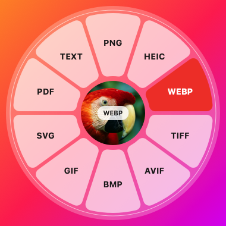
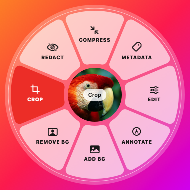
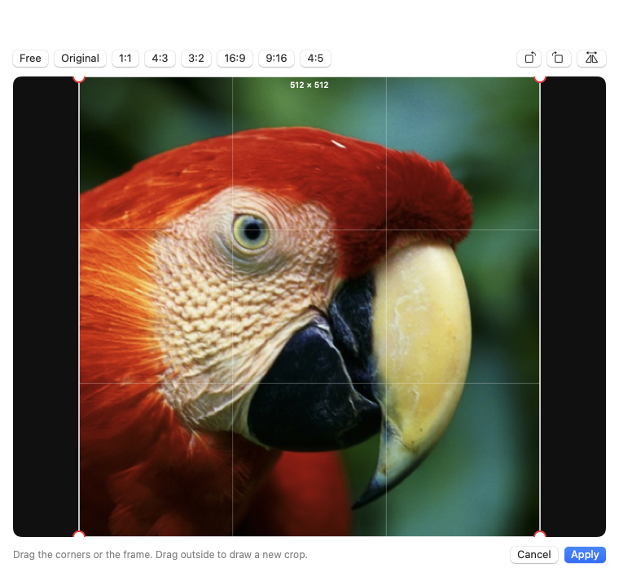
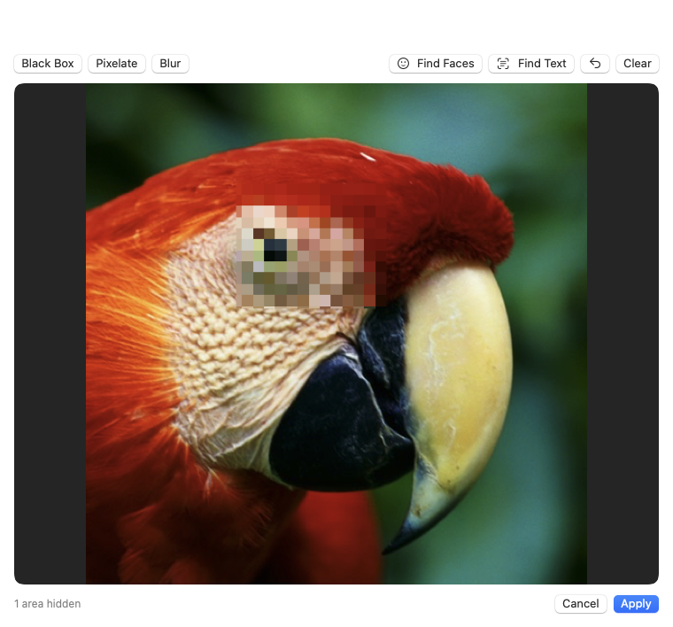
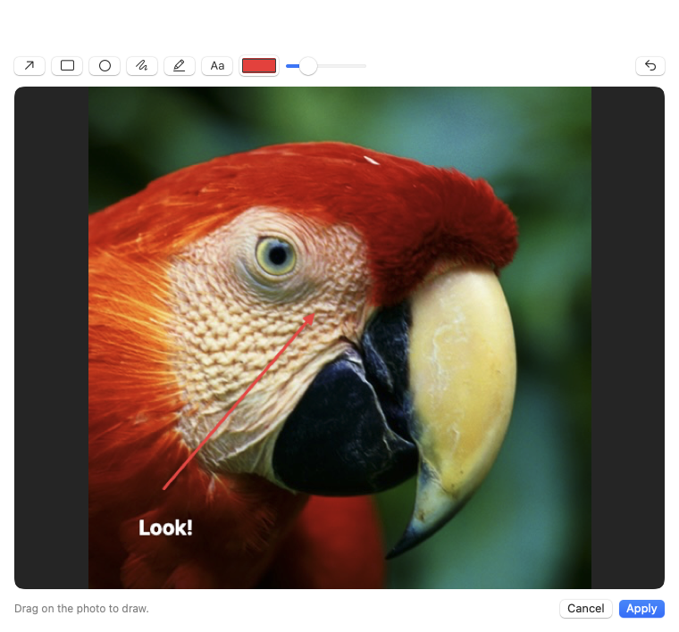
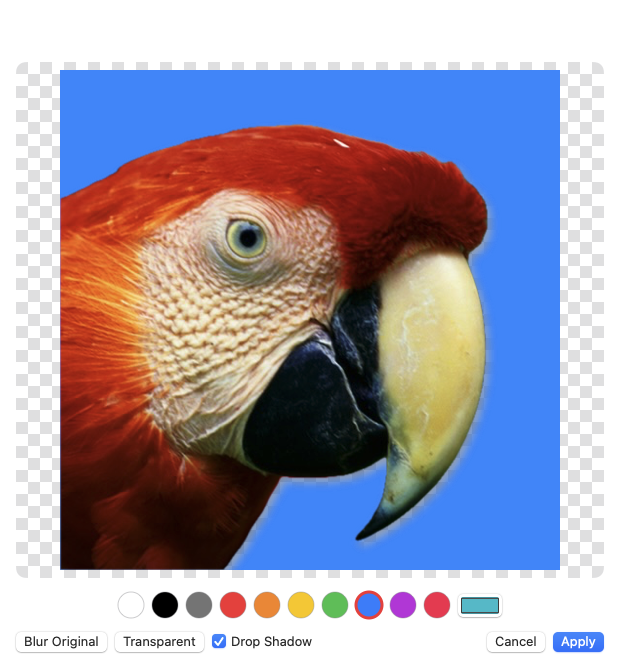
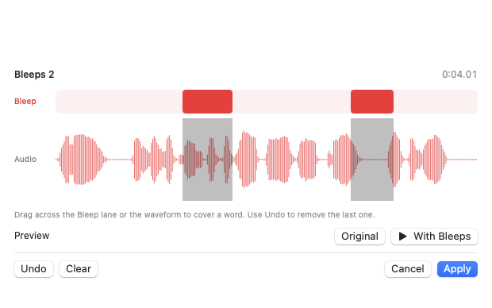
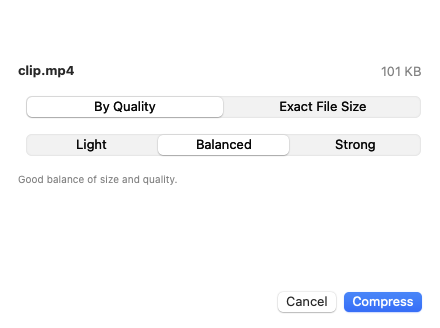

<p align="center"></p>

<h1 align="center">DropWheel</h1>

<p align="center">Convert and edit files right from a Finder drag. Free, open source, and 100% on-device.</p>

<p align="center">
  
  
</p>

Hold **Shift** while dragging a file in Finder and a wheel of output formats appears around your pointer.
Drop the file on the format you want, and the converted copy is saved right beside the original. Hold
**Option + Shift** instead, and the wheel fills with tools for that exact kind of file.

Everything happens on your Mac. Your files are never uploaded, so private documents, photos, and their
metadata never leave your computer.

---

## Features

### Convert (Shift)

| | Formats |
|---|---|
| **Images** | JPEG, PNG, HEIC, WebP, TIFF, AVIF, BMP, GIF, SVG, PDF, text (OCR) |
| **Video** | MP4, MOV, MKV, AVI, WMV, WebM, GIF, plus audio as MP3 / M4A / WAV |
| **Audio** | MP3, M4A, WAV, FLAC, OGG, Opus, AIFF |
| **PDF** | TXT, DOCX, RTF, HTML, PNG, JPG, HEIC, TIFF |
| **Documents** | PDF, DOCX, TXT, RTF, HTML, ODT, DOC |
| **Subtitles** | SRT ⇄ VTT, plain text |
| **Archives** | Extract (ZIP, TAR, GZ, TGZ, RAR, 7z…), ZIP, TAR, TGZ, GZIP |

### Tools (Option + Shift)

- **Compress** images, video, audio and PDFs by quality, or aim for an exact file size.
- **Photos:** crop (with aspect presets, rotate and flip), adjust (exposure, contrast, highlights, shadows,
  warmth…), annotate (arrows, shapes, pen, highlighter, text), redact (black box, pixelate or blur, with
  automatic face and text detection), remove the background, or add a new one (color, blur or transparent,
  with drop shadow).
- **Video:** trim, crop, split, change speed (0.25×–4×), take snapshots, mute, join several clips.
- **Audio:** trim (with silence detection), bleep words, normalize, convert channels (mono/stereo, per-side
  volume), fade, reverse, join.
- **PDFs:** organize pages (reorder, rotate, duplicate, delete), merge, split, rotate, export pages as
  images, OCR scanned pages.
- **Metadata:** view everything, edit title/author/copyright/keywords/tags, remove GPS, or strip it all.
- **Multiple files:** combine images into a PDF or a collage, merge PDFs, join videos or audio.

<p align="center">
  
  
  
  
  
  
</p>

---

## Install

### Download

1. Get the latest `DropWheel-x.y.z.zip` from [Releases](https://github.com/Mosabhavi/DropWheel/releases).
2. Unzip it and drag **DropWheel.app** into **Applications**.
3. The app isn't notarized, so open it the first time with **right-click → Open → Open**. You can also run
   this once:

   ```bash
   xattr -dr com.apple.quarantine /Applications/DropWheel.app
   ```

### Build from source

Requires macOS 15+ and Xcode 16+ (or the Command Line Tools).

```bash
git clone https://github.com/Mosabhavi/DropWheel.git
cd DropWheel
./build-app.sh
open DropWheel.app
```

### Optional: extra formats

macOS can't write MP3, OGG, Opus, MKV, AVI, WMV, WebM or WebP on its own. Install the free encoders and
DropWheel picks them up automatically:

```bash
brew install ffmpeg webp
```

Without them, those wheel segments explain what's needed when you drop on them. Everything else works
out of the box.

---

## How to use it

DropWheel lives in the **menu bar** (◎). It has no Dock icon and needs no special permissions.

1. **Convert:** start dragging a file in Finder, then hold **Shift**. Drop on a format.
2. **Tools:** start dragging, then hold **Option + Shift**. Drop on a tool.
3. **Cancel:** drop on the middle of the wheel, or outside it.

Notes:

- You can switch between the two wheels mid-drag by pressing or releasing **Option**.
- Results are saved next to the original, for example `photo.png → photo.jpg` or `photo cropped.png`.
  The original is never changed, and nothing is overwritten (`photo 2.jpg`…).
- Drag several files at once to convert them all, or to merge, join or collage them.
- Tools such as Crop, Redact, Annotate, Trim, Bleep and Compress open a small window. Adjust, then click
  **Apply**.

### Menu bar options

- **Trigger Key:** use **Shift** (default), **Command** or **Control** to open the wheel. Option is always
  added for tools.
- **Open at Login**.
- **How to Use** shows the gesture reminder again.

### Troubleshooting

**The wheel doesn't appear**

- Press the trigger key *after* the drag has started.
- Make sure ◎ is in the menu bar, and check which trigger key is selected there.

**"… needs ffmpeg"**

Run `brew install ffmpeg webp`, then try again. You don't need to restart DropWheel.

**Big videos seem slow**

Watch the notice at the bottom of the screen. It shows progress, then *Saved …*.

---

## Privacy

No network access, no analytics, no accounts. All processing uses Apple's built-in frameworks (ImageIO,
AVFoundation, PDFKit, Vision, Core Image), or your local ffmpeg.

## Contributing

Issues and pull requests are welcome. See [CONTRIBUTING.md](CONTRIBUTING.md).

## License

[MIT](LICENSE)
